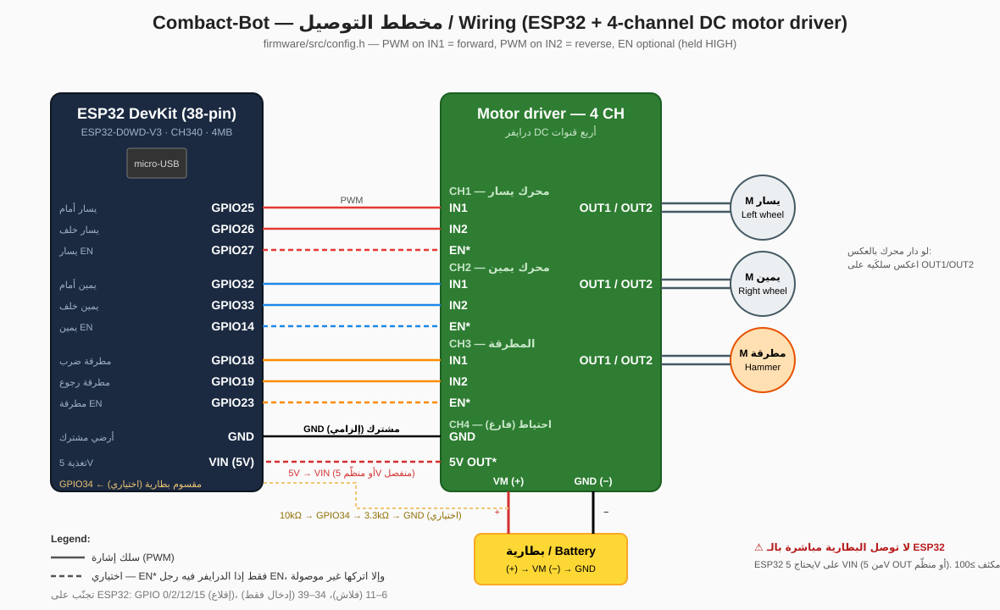

# مخطط التوصيل | Wiring — ESP32 + درايفر DC 4 قنوات

> الفيرموير مضبوط على هذه الأرجل في `firmware/src/config.h`. لو وصلت غير ذلك عدّل الأرجل هناك وأعد الحرق.

## 1) ESP32 → الدرايفر (إشارات)

| سلك من ESP32 | إلى الدرايفر | الوظيفة |
|---|---|---|
| GPIO25 | CH1 IN1 (أو IN A) | محرك يسار — أمام |
| GPIO26 | CH1 IN2 (أو IN B) | محرك يسار — خلف |
| GPIO27 | CH1 EN / ENA *(إن وُجد)* | تفعيل قناة اليسار |
| GPIO32 | CH2 IN1 | محرك يمين — أمام |
| GPIO33 | CH2 IN2 | محرك يمين — خلف |
| GPIO14 | CH2 EN / ENB *(إن وُجد)* | تفعيل قناة اليمين |
| GPIO18 | CH3 IN1 | المطرقة — ضرب |
| GPIO19 | CH3 IN2 | المطرقة — رجوع |
| GPIO23 | CH3 EN *(إن وُجد)* | تفعيل قناة المطرقة |
| GND | GND | **أرضي مشترك — إلزامي** |

- لو الدرايفر **بدون** أرجل EN (مثل L9110S / DRV8833): اترك GPIO27 / 14 / 23 غير موصولة.
- لو الدرايفر فيه جمبر EN على 5V (مثل L298N): اترك الجمبر وأرجل EN غير موصولة، أو انزع الجمبر ووصّلها كما بالجدول — الاثنان يعملان.
- القناة CH4 فارغة (احتياط).

## 2) الدرايفر → المحركات

| مخرج الدرايفر | المحرك |
|---|---|
| CH1 OUT1 / OUT2 | محرك العجلة اليسرى |
| CH2 OUT1 / OUT2 | محرك العجلة اليمنى |
| CH3 OUT1 / OUT2 | محرك المطرقة |

لو محرك دار بالاتجاه المعاكس عند التجربة: **اعكس سلكَي ذلك المحرك** على مخرج الدرايفر (لا تغيّر الكود).

## 3) الطاقة

| من | إلى |
|---|---|
| بطارية (+) | الدرايفر VM / VCC-Motor (+) |
| بطارية (−) | الدرايفر GND |
| الدرايفر 5V OUT *(إن وُجد)* أو منظّم 5V منفصل | ESP32 **VIN/5V** |
| الدرايفر GND | ESP32 GND |

- **لا توصل البطارية مباشرة بالـ ESP32.** يحتاج 5V على VIN (أو 3.3V على 3V3).
- أثناء التطوير: شغّل الـ ESP32 من USB الحاسوب، وأبقِ GND مشتركاً مع الدرايفر.
- مكثف 100µF+ على مدخل تغذية الدرايفر يقلل إعادة تشغيل الـ ESP32 عند انطلاق المحركات.

## 4) قياس البطارية (اختياري)

مقسوم جهد: بطارية (+) → **10kΩ** → GPIO34 → **3.3kΩ** → GND. آمن حتى ~16V. لو لا تريده ضع `PIN_BATT_ADC -1` في `config.h` (التليمتري يعرض 0 mV فقط).

## 5) أرجل يجب تجنّبها على ESP32

- **0, 2, 12, 15**: أرجل إقلاع (strapping) — قد تمنع الإقلاع أو تخرّب جهد الفلاش.
- **6–11**: موصولة بذاكرة الفلاش داخلياً.
- **34–39**: إدخال فقط (لا تصلح للـ PWM).

## 6) خطوات التجربة الأولى

1. ارفع العجلات عن الأرض، **اترك المطرقة مفصولة** في التجربة الأولى.
2. شغّل الـ ESP32 → LED تومض بسرعة (failsafe، لا يوجد اتصال).
3. من الموبايل اتصل بشبكة `COMBACT-BOT` / كلمة السر `combact123`، افتح التطبيق → LED ثابتة، وشريط التليمتري يعرض Rx ≈ 50 Hz.
4. حرّك الجويستيك للأمام: العجلتان للأمام. لو واحدة بالعكس اعكس سلكَيها.
5. أطفئ WiFi في الموبايل: يجب أن تتوقف المحركات خلال 300ms.
6. وصّل المطرقة، فعّل ARM، جرّب السلايدر ثم FIRE.
